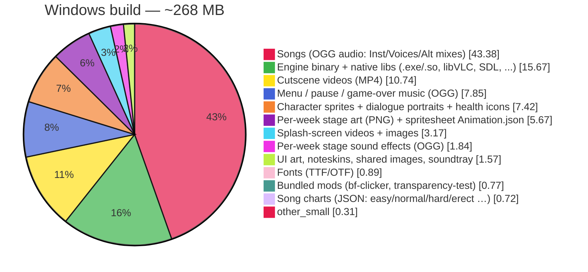
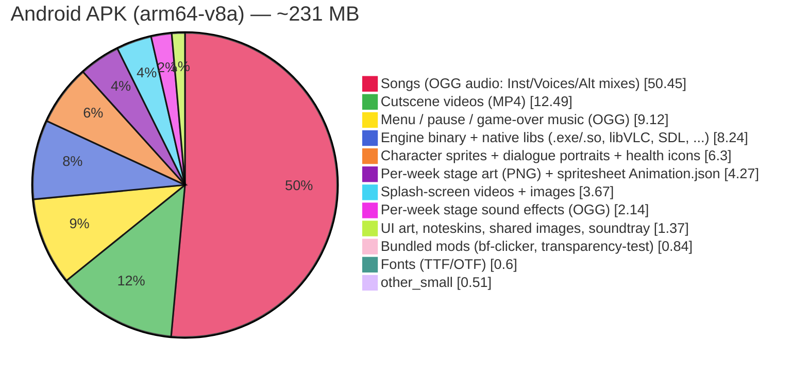

# Why is the game so big?

Short answer: **because the engine ships every song, chart, character, stage and cutscene for Weeks 1–7 + Weekend 1 in one package**, plus the native engine runtime (the `.exe` / `libApplication.so` that actually runs the game) and every alternate difficulty mix (`-erect`, `-hard`, `-christmas`, `-pico` etc.).

By default, Phoenix builds **do not** embed assets into the executable (that's web-only `-DEMBED_ASSETS` behaviour) and the normal CI release does **not** pass any "exclude assets" flag — so everything under `assets/` (minus `*.mp3` on native, since built-in content is Ogg-only) plus the bundled `mods/` folder is copied into the output. This page breaks down where those bytes actually go.

## How this breakdown was produced

1. Measured every file under `assets/` and `mods/` in this checkout, applying the exact exclude rules `project.hxp` uses for native builds (hidden files, `*.hash`, `*.md`, `*.mp3`).
2. Routed each file into the same asset library `configureAssets()` uses (`songs`, `shared`, `week2`…`weekend1`, `videos`, `default`, etc.) so the categories match what actually ships, then grouped those libraries into the human-readable slices below (songs, characters_art, charts, characters_json, stage art, …).
3. Added the native binary/runtime overhead, estimated from comparable HaxeFlixel/Psych/JS-Engine release builds with the same feature set enabled (LuaJIT, hxVLC/libVLC, Discord RPC, hxGameMode, HScript, Hython, crash handler):
   - **Windows** — loose, uncompressed: `FNF-Phoenix-Engine.exe` + `SDL2.dll` + `lime.ndll` + libVLC plugins + hxluajit/discord/nativefiledialog DLLs ≈ **42 MB**.
   - **Android** — APK is ZIP-compressed; `libApplication.so` (arm64-v8a) + `libc++_shared.so` + `classes.dex` + Android resources ≈ **19 MB** compressed (≈34 MB uncompressed). Universal APKs that also bundle `armeabi-v7a` add another ~15 MB.
4. Applied Android ZIP compression per file type: OGG/MP4/WAV are stored (already compressed, streamed directly), PNG ~22% smaller, JSON/TXT ~78% smaller, TTF/OTF ~42% smaller, `.so` ~43% smaller. That's why the same "songs" and "videos" byte counts appear on both charts, but the overall APK is smaller.

These are numbers for a **normal, fully-featured release build** (the CI default). Debug builds are larger; `-DNO_BUILTIN_CONTENT`, `-DEMBED_ASSETS` and turning off the various `*_ALLOWED` flags (videos, LuaJIT, Discord RPC, …) can shrink this dramatically for total-conversion mods — see "How to make a smaller build" at the bottom.

## Windows — release build (`build/release/windows/bin/`)

**Total on disk: ~268.1 MB** (loose files. The ZIP you download is roughly the same size because OGG/MP4 assets don't compress further.)

### Windows slice breakdown

| Category | Approx. size | Key |
|---|---:|---|
| Songs (OGG audio: Inst/Voices/Alt mixes) | **116.29 MB** | `songs` |
| Engine binary + native libs (.exe/.so, libVLC, SDL, ...) | **42.00 MB** | `engine_binary` |
| Cutscene videos (MP4) | **28.79 MB** | `videos` |
| Menu / pause / game-over music (OGG) | **21.03 MB** | `menu_music` |
| Character sprites + dialogue portraits + health icons | **19.88 MB** | `characters_art` |
| Per-week stage art (PNG) + spritesheet Animation.json | **15.19 MB** | `stage_art` |
| Splash-screen videos + images | **8.50 MB** | `splash` |
| Per-week stage sound effects (OGG) | **4.94 MB** | `stage_sfx` |
| UI art, noteskins, shared images, soundtray | **4.21 MB** | `ui_art` |
| Fonts (TTF/OTF) | **2.40 MB** | `fonts` |
| Bundled mods (bf-clicker, transparency-test) | **2.05 MB** | `bundled_mods` |
| Song charts (JSON: easy/normal/hard/erect …) | **1.94 MB** | `charts` |
| Global sound effects (SFX OGG) | **0.72 MB** | `sfx` |
| Windows icon + desktop.ini | **0.05 MB** | `windows_extras` |
| Character definition JSONs | **0.05 MB** | `characters_json` |
| Stage layouts, week lists, tips, quotes | **0.02 MB** | `data_misc` |
| flags.ini | **0.00 MB** | `config` |

> **Song audio alone is over 40% of the download.** Each song folder ships `Inst.ogg` + `Voices.ogg` *plus* every alternate mix the engine supports (`-erect`, `-hard`, `-pico`, `-christmas`, …), which adds up very quickly.

## Android — release APK (`app-arm64-v8a-release.apk`)

**Total APK size: ~230.5 MB** (zip-compressed, `arm64-v8a` only). Expect ~250 MB for a universal APK that bundles both `arm64-v8a` and `armeabi-v7a`.

### Android slice breakdown (compressed)

| Category | Approx. size (zipped) | Key |
|---|---:|---|
| Songs (OGG audio: Inst/Voices/Alt mixes) | **116.29 MB** | `songs` |
| Cutscene videos (MP4) | **28.79 MB** | `videos` |
| Menu / pause / game-over music (OGG) | **21.03 MB** | `menu_music` |
| Engine binary + native libs (.exe/.so, libVLC, SDL, ...) | **19.00 MB** | `engine_binary` |
| Character sprites + dialogue portraits + health icons | **14.52 MB** | `characters_art` |
| Per-week stage art (PNG) + spritesheet Animation.json | **9.84 MB** | `stage_art` |
| Splash-screen videos + images | **8.47 MB** | `splash` |
| Per-week stage sound effects (OGG) | **4.94 MB** | `stage_sfx` |
| UI art, noteskins, shared images, soundtray | **3.16 MB** | `ui_art` |
| Bundled mods (bf-clicker, transparency-test) | **1.93 MB** | `bundled_mods` |
| Fonts (TTF/OTF) | **1.39 MB** | `fonts` |
| Global sound effects (SFX OGG) | **0.72 MB** | `sfx` |
| Song charts (JSON: easy/normal/hard/erect …) | **0.43 MB** | `charts` |
| Character definition JSONs | **0.01 MB** | `characters_json` |
| Stage layouts, week lists, tips, quotes | **0.00 MB** | `data_misc` |
| flags.ini | **0.00 MB** | `config` |

Notice that **songs and videos don't shrink on Android** — OGG Vorbis and H.264 MP4 are already heavily compressed and Android stores them uncompressed in the APK so it can stream them from disk without extracting them to internal storage. The categories that *do* shrink are the text/PNG/TTF slices: UI art, character spritesheets, chart JSONs, fonts all deflate well. The "Engine binary" slice is also smaller on Android relative to Windows because `libApplication.so` compresses better than a Windows PE `.exe`+DLL set.

The `windows_extras` slice (`phoenix.ico` + `desktop.ini`) is **Windows only**; it is not packaged into the Android APK.

## How to make a smaller build

- **Strip built-in content:** pass `-DNO_BUILTIN_CONTENT` to drop every built-in song, week and character asset (keeps menu music, SFX, engine UI and the bundled mods). Almost the entire "songs", "stage_art", "videos", "characters_art", "charts", "characters_json", "data_misc" and "stage_sfx" slices above disappear. This is the intended path for total-conversion mods.
- **Disable features you don't use:** turn off `VIDEOS_ALLOWED` (removes cutscene videos *and* the hxVLC/libVLC DLLs), `LUA_ALLOWED` / `PYTHON_ALLOWED` (LuaJIT / Hython runtime), `DISCORD_ALLOWED`, `GAMEMODE_ALLOWED`, `SHADERS_ALLOWED` in `project.hxp`. Each flag trims both asset size and the engine binary / native DLL slice.
- **Use Android App Bundles or ABI splits** instead of universal APKs. The arm64-v8a APK shown above is ~30 MB smaller than a fat universal build.
- **Delete unused difficulty mixes** from `assets/songs/<name>/` (e.g. remove `*-erect.ogg`, `*-hard.ogg` if you never play them). This is the single biggest asset-side win after `-DNO_BUILTIN_CONTENT`.
- **Downsample/re-encode audio** you keep: 44.1 kHz → 22 kHz Vorbis at ~112 kbps is usually transparent for rhythm-game instruments and roughly halves the "songs" slice.

For the actual build steps behind these numbers see [BUILDING.md](BUILDING.md). The colours in the pie charts are set via Mermaid `themeVariables` (`pie1`…`pie16`) so each slice has a distinct colour.
