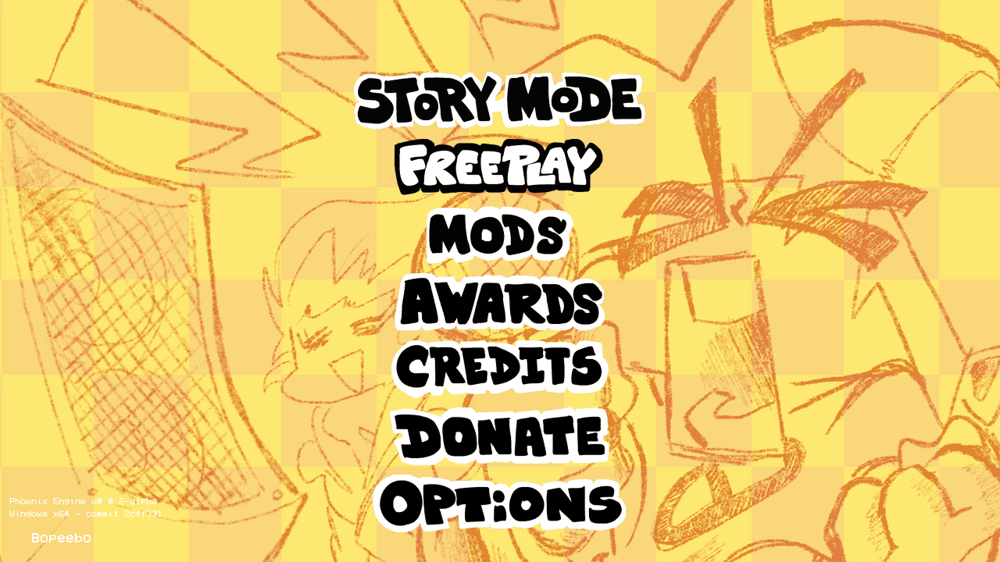
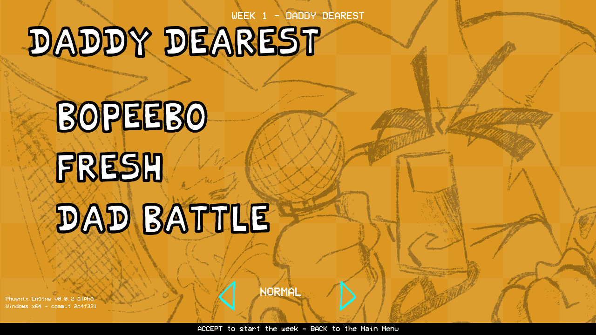
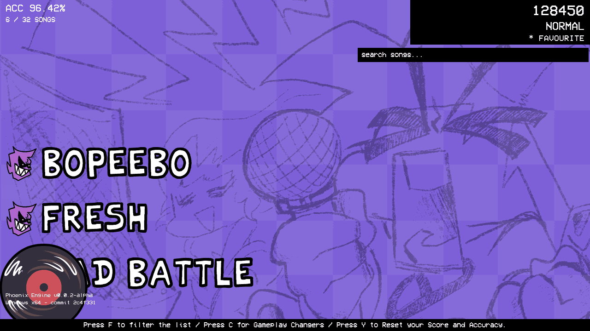
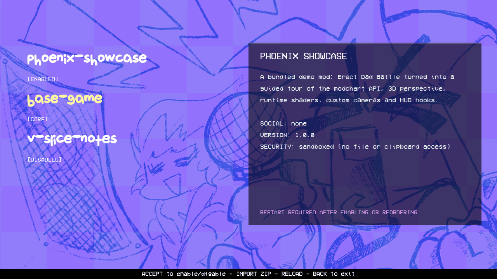
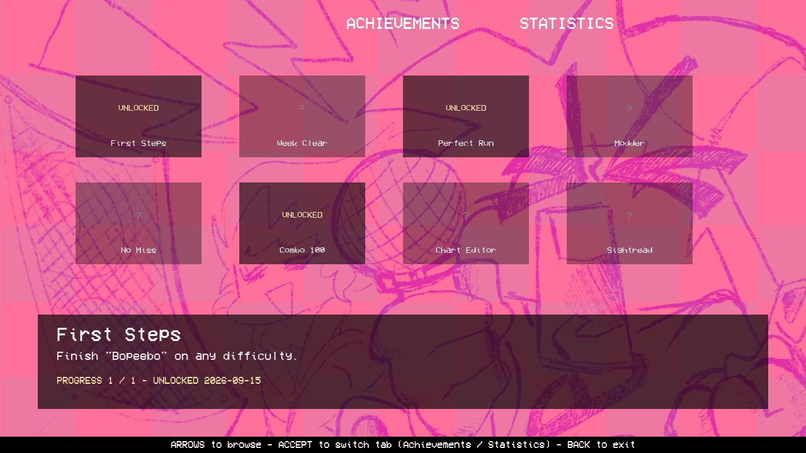
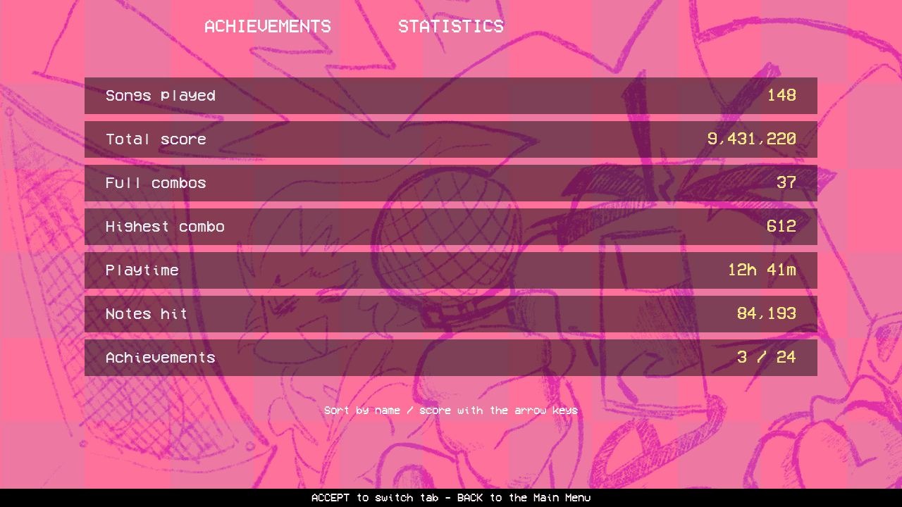
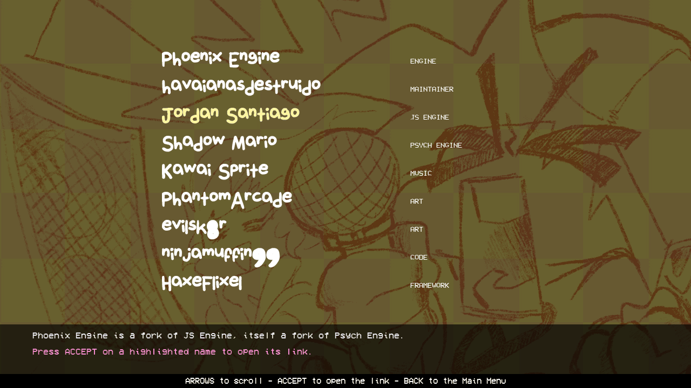
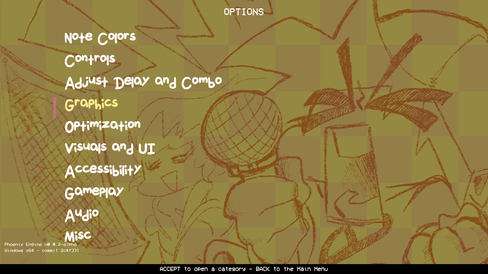
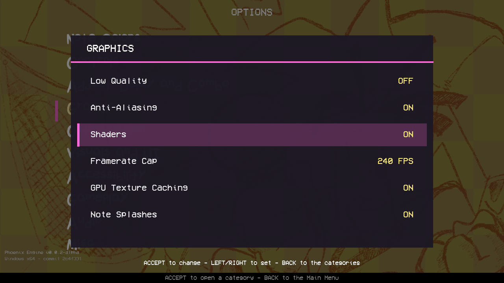

# Menus

Every menu here is a `MusicBeatState`, so it gets the engine's beat callbacks, the
`FlxTransitionableState` fade, per-state asset caching and the optional HScript overlay
from `data/states/<ClassName>.hx`. Menus share the same backdrop pair
(`menuBG` + `MovingCheckerboard`) unless they re-tint `menuDesat` to the selected week's
colour.

## Main menu

`source/states/MainMenuState.hx`. Seven `menu_*` Sparrow atlases, each with `basic` and
`white` animations, stacked from the top in `menuOptions` order and centered on X.

| Order | Option | Opens |
|---|---|---|
| 1 | Story Mode | `StoryMenuState` |
| 2 | Freeplay | `FreeplayState` |
| 3 | Mods (`MODS_ALLOWED` only) | `ModsMenuState` |
| 4 | Awards | `AchievementsMenuState`, or `StatsState` without `ACHIEVEMENTS_ALLOWED` |
| 5 | Credits | `CreditsState` |
| 6 | Donate | the repository URL in the browser (`CoolUtil.browserLoad`) |
| 7 | Options | `options.OptionsState` through `LoadingState` |

The `mods` entry disappears when `backend.RecoveryBoot.disableMods` is armed, so safe
mode cannot re-enable the mod that broke the boot. On desktop the debug key opens
`MasterEditorMenu` directly, which is the only path into the editors without a chart.

Around the list: the version label bottom-left (`Phoenix Engine v…`, plus the platform
badge from `objects.PlatformIcon`), the rotating tips from `funnyTips.txt` in the bottom
band, and the achievement popup camera (`camAchievement`) reserved above the menu.

## Story mode

`source/states/StoryMenuState.hx` reads `assets/preload/data/weeksList.txt` through
`backend.WeekData`. One row per unlocked week, each showing `storyName`, the week's song
titles from `weekFile.songs`, and `weekCharacters` rendered as the three characters.
`weekBefore` gates the unlock; `hiddenUntilUnlocked` hides a locked week instead of
showing it greyed.

The difficulty selector is the two `campaign_menu_UI_assets` arrows with the current
difficulty between them. A week with only one chart hides the arrows. Entering a week
sets `PlayState.storyPlaylist`, `PlayState.isStoryMode = true` and the difficulty index,
then goes through `LoadingState`.

## Freeplay

`source/states/FreeplayState.hx`. The list is one `Alphabet` row per song at
`contentLeft + 90`, starting at `y = 320` and 120px apart, with a `HealthIcon` per row
using the song's `songCharacter`.

- The backdrop `menuDesat` sprite is tinted with the selected song's `color` from its
  week, tweened on selection.
- The record bottom-left is the `Freeplay_Discs` atlas, spinning on the beat.
- Top-right: score and `lastDifficultyName` in VCR, the `★` favourite marker, and the
  song search `FlxUIInputText`.
- Bottom bar text is context-sensitive: `PRELOAD_ALL` builds offer `SPACE` to listen and
  `CTRL` for gameplay changers, mobile swaps the wording for touch buttons.
- `FreeplayFilterSubState` (`F`) narrows the list by mod, `GameplayChangersSubstate`
  (`C`) opens modifiers, `ResetScoreSubState` (`Y`) clears the run's score and accuracy.

Starting a song sets `PlayState.isStoryMode = false`, `wasOriginallyFreeplay = true`, and
`LoadingState.loadAndSwitchState(PlayState.new)`.

## Mods

`source/states/ModsMenuState.hx`. Left column is the load-order list with an enabled
marker; right panel is the selected mod's `pack.json`: name, description, social links,
version, and the security state from `backend.ModSecurity` (whether the mod's scripts run
sandboxed and which allowlisted calls it declares). `RESTART REQUIRED` is shown when the
enabled set or order changed, because mods are loaded before the menus.

`ModInfoSubState` opens the full `pack.json`, the `.zip` import button unpacks a pack
into `mods/`, and `backend.ModHealthReport` backs the health line for packs that failed to
parse.

## Awards and Statistics

Both tabs are owned by `source/states/AchievementsMenuState.hx` (`ACHIEVEMENTS_ALLOWED`)
and `source/states/StatsState.hx`, sharing the same shell: a grid of achievement tiles
with the unlocked ones lit, a details box under the grid with name, description and
`PROGRESS x / y`, and the tab switch on `ACCEPT`. Statistics reuse the frame for totals
from `backend.PlayerStats`: songs played, total score, full combos, highest combo,
formatted playtime (`PlayerStats.formatPlaytime`) and achievements unlocked.

## Credits

`source/states/CreditsState.hx`. One `Alphabet` row per credit with a role label and an
optional icon; selectable rows open their link on `ACCEPT`, and the description panel at
the bottom follows the highlighted row. Rows come from `assets/preload/data/credits.txt`
so a source mod can replace the whole list without touching the state.

## Options

`source/options/OptionsState.hx`. Ten categories, 56px apart, in this order: Note Colors,
Controls, Adjust Delay and Combo, Graphics, Optimization, Visuals and UI, Accessibility,
Gameplay, Audio, Misc — plus Mobile Options on Android/iOS.

Each category is a `BaseOptionsMenu` substate: `options/GraphicsSettingsSubState`,
`OptimizationSubState`, `VisualsUISubState`, `AccessibilitySubState`,
`GameplaySettingsSubState`, `AudioSettingsSubState`, `MiscSettingsSubState`,
`ControlsSubState`, `NotesSubState`, `NoteOffsetState` and
`GameRendererSettingsSubState`. The constructor takes an optional category label, which
is what `phoenix://menu/misc` and `phoenix://menu/audio` use to open straight into a
category.

## Options category substate

A category substate dims the Options list behind it and draws its own scrollable rows
through `BaseOptionsMenu`. Each row is an `Option` (checkbox, number, choice, string or
key bind) with its label on the left and the current value on the right; `Option.onlyOn`
and `PlatformSupport.requirementsForPreference()` decide which rows exist on the running
platform, which is why Graphics looks different on mobile.
