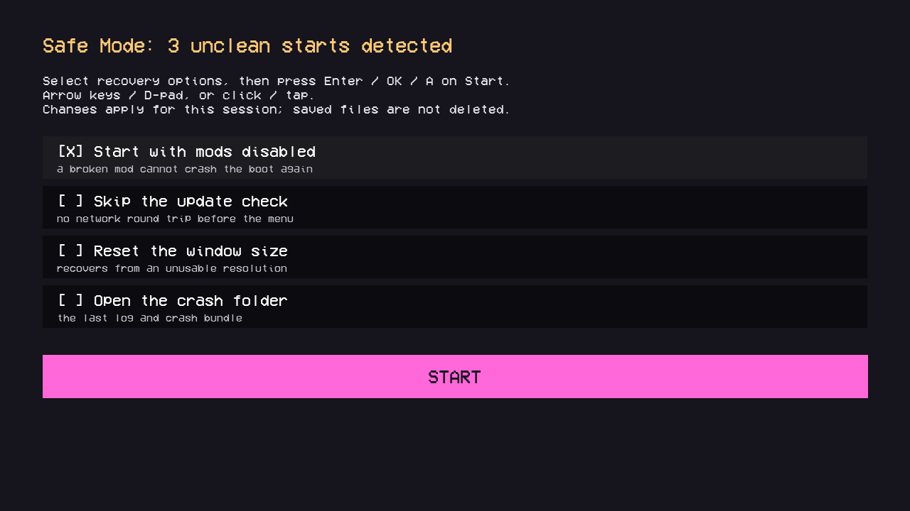
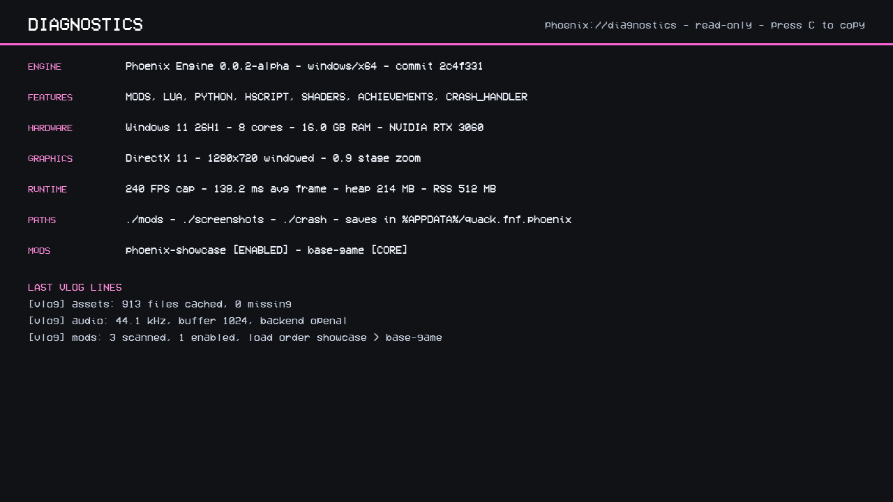
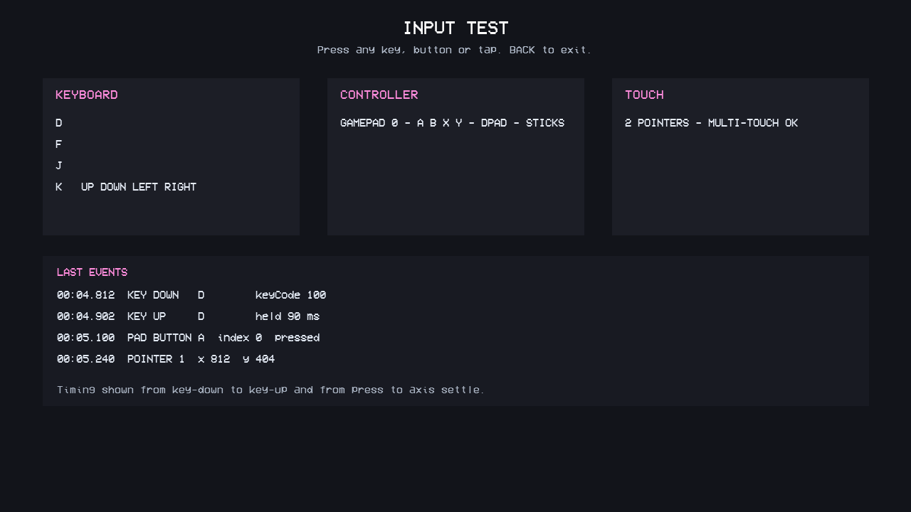
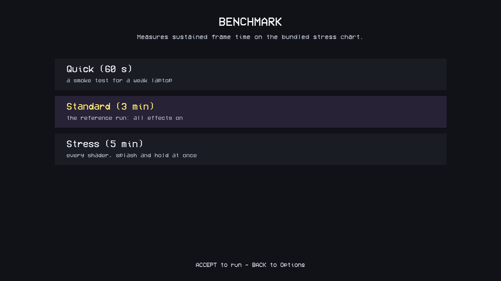
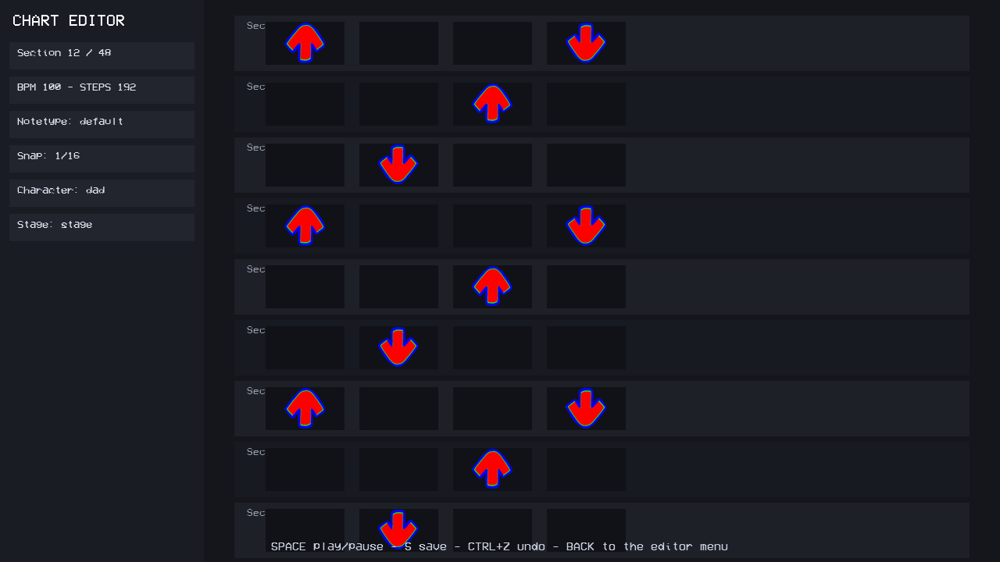

# Support and tooling screens

These screens are the ones a support thread asks for by link, plus the tools the engine
ships for authoring.

## Safe mode (`RecoveryState`)

`source/states/RecoveryState.hx` is entered by `backend.RecoveryBoot` when the session log
shows repeated unclean starts. It reads `Safe Mode: <n> unclean starts detected`, prints
two lines of help, then four rows and a Start row — the same `60 / 105 / 200 + i * 70`
vertical rhythm the state uses.

The choices are applied for the session only and nothing on disk is deleted:
disable mods, skip the update check, reset the window size, and open the crash folder.
Starting hands control back to `InitState`, so the normal boot chain runs with the
recovery flags armed.

## Diagnostics (`DiagnosticsState`)

`source/states/DiagnosticsState.hx` renders one snapshot built by
`backend.DiagnosticsReport`, designed to be photographed rather than read in a terminal
(sections are chosen to fit roughly one screen):

| Section | Contents |
|---|---|
| Build | version, commit, target, feature flags, launch arguments |
| Hardware | OS, CPU, RAM, GPU and driver, graphics and audio API |
| Runtime | viewport, scale mode, framerate targets, uptime, heap, RSS |
| Paths | working directory, save-data id, session log, crash folder, mods folder |
| Mods | every enabled mod in load order |
| Settings | only the preferences that change feel or performance |
| Log | the last ten `vlog` lines |

Two ways in: `phoenix://diagnostics` and Options → Misc. The page is read-only — it does
not touch prefs, so the report cannot rewrite the numbers it is showing.

## Input tester (`InputTestState`)

`source/states/InputTestState.hx`, opened from `phoenix://input` or Options →
Accessibility. The counting lives in `backend.InputTestLogic`, and the state is only a
view over it: one panel per device (keyboard, each connected controller, touch), the live
key/button list, and a timing readout so a player can tell a dropped input from a broken
key.

## Benchmark hub (`BenchmarkMenuState`)

`source/states/BenchmarkMenuState.hx` is reached from Options → Optimization and lists
one row per `BenchmarkKind`: `GAMEPLAY`, `VISUAL`, `LOGIC`, `SYNTHETIC` and `SUITE`, each
with what it measures and how long it takes. Rows are 48px high and reuse the `Alphabet`
list from the option screens.

`SYNTHETIC` finishes immediately; the gameplay kinds run `LoadingState → PlayState` with
a `FrameProfiler` session and land on `BenchmarkResultsState`. Every run disables mods
for its duration through `backend.Benchmark.startKind()`.

## Chart editor (`ChartingState`)

`source/editors/ChartingState.hx`, opened from `MasterEditorMenu` (debug key on desktop)
or from PlayState's edit key. Left column holds the section/BPM readout, notetype and
snap selectors, the character and stage pickers and the waveform panel; the grid on the
right is one row per section with four note lanes, a playhead, and the section list
behind it.

The editors share the same shell (`source/editors/`): `CharacterEditorState`,
`StageEditorState`, `WeekEditorState`, `DialogueEditorState`,
`DialogueCharacterEditorState`, `MenuCharacterEditorState`, `ModchartLabState` and
`NoteSplashDebugState`. They write to `data/` and `assets/`, which is why
`backend.ModSecurity` treats editor builds differently from play builds.
